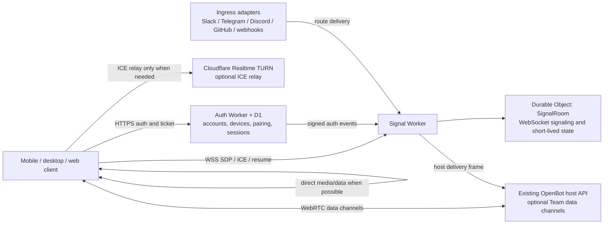

# Cloudflare remote infrastructure

Status: implementation in progress; no Cloudflare resource has been deployed by this work. Recheck
the live quota and price links immediately before production enablement.

## Target architecture

The personal remote session path is authoritative. Cloudflare carries authentication metadata,
pairing/signaling, route delivery envelopes and short-lived coordination state; it does not store
chats, files, commands, or event payloads. Existing host data channels remain unchanged. Multi-user
Team membership and Team API migration are optional and are not prerequisites for the personal path.

The current implementation uses one named `SignalRoom` object. This is a small compatible
migration topology, not the final high-scale topology. Any sharding change must preserve ticket
claims, resume semantics, route ownership, and protocol frames.

## Implemented boundary

- `apps/signal-worker` verifies existing ES256 remote tickets through the Auth Worker JWKS.
- It issues compatible short-lived HS256 resume tokens and persists replay/revocation markers in
  Durable Object SQLite storage.
- It relays host/client SDP and ICE frames, refreshes TURN credentials, enforces message and body
  limits, and handles auth/session invalidation events.
- Personal remote tickets can opt into the Worker through `REMOTE_SIGNAL_WORKER_URL`; blank keeps
  current Bun behavior unchanged. Team membership is not required for this path.
- Generic webhook ingress can be forwarded to a Worker-connected host. Signature verification and
  route authorization remain host-side.
- Slack and GitHub signed ingress, Telegram update delivery, and a bounded subset of Telegram Bot API
  calls can use the Worker when `REMOTE_SIGNAL_INGRESS_WORKER_URL` is configured.
- Sealed queue delivery is implemented for Slack and Telegram with host-side decryption, ACKs, TTL and
  per-host bounds. GitHub is intentionally not queueable.
- Discord route tickets, a raw Gateway client, normalized message/interaction delivery, route
  reconciliation, session-scoped REST, uploads and interaction replies are present in the Worker.
  The Worker reuses the existing pure Discord normalizer; the Bun Gateway remains available as the
  rollback path until a live canary is approved.

## Ordered implementation plan

| Phase | Work | Depends on | Exit condition |
| --- | --- | --- | --- |
| 0. Baseline | Fork, branch, license review, protocol inventory, dry-run-only policy | None | Fork is the only write target; no deployment credentials are used |
| 1. Personal signaling | Worker, DO WebSocket pairing, ticket validation, resume, SDP/ICE relay | 0 | One owner can connect the desktop host and mobile client with reconnect |
| 2. TURN | Realtime TURN provider, bounded TTL, redacted failures | 1 | Direct ICE and relay ICE both work; TURN token never reaches logs or repository |
| 3. Revocation | Persistent replay, host/session revocation, signed auth events and alarms | 1 | Revoked tickets and sessions are rejected without restarting the Worker |
| 4. Generic webhook | Route ticket, signed public ingress, host-side verification, delivery result | 3 | Valid delivery reaches the correct host; invalid, stale and revoked routes fail safely |
| 5. Bot adapters | Slack/GitHub ingress, Telegram, sealed queue, Discord Gateway and REST parity | 4 | Each migrated adapter preserves payload/signature/ack semantics and has focused tests |
| 6. Cutover | Configure URLs, canary, observe, rollback plan | 5 | Canary is stable, quotas are visible, and rollback to Bun is tested |
| 7. Cleanup | Remove machine-specific Signal homes after a measured migration window | 6 | No client or ingress dependency remains on the retired path |

No phase creates a resource or incurs a charge automatically. Production enablement is a separate,
explicit operator action after phase exit conditions are met.

## Acceptance criteria

### Authentication and authorization

- Tickets validate issuer, audience, signature, protocol range, role, host/session claims, and expiry.
- Replay is rejected by `jti`; resume tokens are audience-bound, short-lived, and rejected after
  host/session revocation.
- Auth event requests require a fresh HMAC signature and bounded body.
- Route tickets are bound to route, host, and link timestamp; `through` revocation does not remove
  newer links.
- Secrets and bearer tokens are never logged, persisted in D1/DO, or sent to clients.

### Signaling and compatibility

- Pairing preserves `hello`, `ready`, `host-waiting`, `peer-ready`, SDP, ICE, TURN refresh,
  replacement-socket, error, and disconnect meanings.
- Clients fall back to Bun when Worker routing is not configured.
- WebSocket messages and public webhook bodies are bounded to 64 KiB and rate-limited where applicable.
- Discord Gateway events are normalized before host delivery; interaction acknowledgement happens before
  host work, and interaction tokens are never sent to hosts.
- Mobile and desktop personal remote behavior remains unchanged; chat data and commands stay on
  existing host data channels. Team membership is optional.

### Operations and cost

- Wrangler validation and dry-run succeed without creating a Worker, DO namespace, D1 database, TURN
  key, DNS record, or custom domain.
- Production has quota alarms, egress monitoring, and a rollback switch to Bun.
- TURN is an ICE fallback. SFU is not required for the current one-host/one-client personal path; any
  future SFU use needs a separate cost and capacity review.

## Verification matrix

| Area | Narrow check | Required result |
| --- | --- | --- |
| Worker | `bun run --cwd apps/signal-worker test` | Auth signatures and route helpers pass |
| Types | `bun run --cwd apps/signal-worker typecheck` | Worker and DO bindings typecheck |
| Formatting | `bunx biome check apps/signal-worker` | No formatting or lint drift |
| Packaging | `bunx wrangler deploy --config apps/signal-worker/wrangler.jsonc --dry-run --env=""` | Upload generated; no deployment |
| Auth API | Focused tests and typecheck | Optional Worker URL is inert when blank |
| Protocol | Host/client integration harness | Frames and reconnect behavior match Bun |
| Ingress | One focused test per adapter | Signature, dedupe, ack, retry, revocation match current behavior |
| Cost guard | Quota/egress dashboard review | No unbounded TURN/SFU or DO traffic is enabled |

## Risks and controls

| Risk | Impact | Control |
| --- | --- | --- |
| One global DO becomes a bottleneck | Connection and CPU concentration | Keep as migration topology; measure; shard only with protocol-preserving tickets |
| DO eviction loses active in-memory sockets | Connected clients disconnect | Reconnect/resume path; persist replay/revocation facts; test eviction behavior |
| Ingress parity gap | Missed or duplicated bot messages | Keep Bun routes active until adapter tests and canary pass |
| TURN/SFU egress exceeds allowance | Unexpected bill | Prefer direct ICE, cap TTL, monitor egress, set alerts, stop relay on budget breach |
| Discord Gateway remains an outbound DO connection | Continuous DO duration and reconnect traffic | Enable only with the Discord bot secret, keep one bounded Gateway instance, monitor duration, and retain Bun rollback |
| Free quotas are exceeded | Requests fail or service is throttled/blocked | Treat allowances as finite; alert before limits; keep Bun rollback |
| License misuse | Legal exposure | PolyForm Noncommercial is suitable for personal/noncommercial use; obtain permission before commercial use |
| Secret or payload leakage | Security/privacy incident | Scoped tokens, HMAC events, no payload persistence, redacted errors, bounded bodies |

## Cost and quota notes

As of 2026-11-15, verify the live terms before deployment:

- [Workers limits](https://developers.cloudflare.com/workers/platform/limits/): free requests and
  CPU limits are finite and plan dependent, not an unlimited service guarantee.
- [Durable Objects pricing](https://developers.cloudflare.com/durable-objects/platform/pricing/):
  free-plan request and duration allowances are finite daily quotas.
- [D1 pricing](https://developers.cloudflare.com/d1/platform/pricing/): reads, writes, and storage
  are finite allowances; D1 is not needed by the current Signal Worker.
- [Realtime TURN FAQ/pricing](https://developers.cloudflare.com/realtime/turn/faq/): relay egress
  is metered after the published shared allowance; ingress does not make the whole session free.
- [Realtime SFU pricing](https://developers.cloudflare.com/realtime/sfu/platform/pricing/): SFU
  egress has its own metering and allowance. “Free” means within published allowance and plan
  conditions, not unlimited capacity or guaranteed zero cost.

The current design uses TURN only as an ICE fallback and does not use SFU. Future multi-party media
requires a separate capacity, privacy, and cost review.

## Required operator inputs

Configure these only through a secret manager or Cloudflare dashboard; never paste secret values
into chat or commit them:

1. Cloudflare account, intended Workers/Durable Objects plan, and chosen custom domain.
2. Narrowly scoped API token for Realtime TURN credential generation, plus TURN key ID. Do not reuse
   this API token as an application secret.
3. Auth Worker JWKS URL, `REMOTE_SESSION_SECRET`, and separately generated
   `REMOTE_AUTH_WEBHOOK_SECRET`.
4. DNS/custom-domain ownership for `signal-worker.openbot.run`, or a replacement hostname.
5. Deliberate `REMOTE_SIGNAL_WORKER_URL`, optional `REMOTE_SIGNAL_INGRESS_WORKER_URL`, and the
   Worker `/internal/auth-events` URL in Auth API webhook fan-out configuration.
6. Discord bot token/application ID and the Message Content intent decision, if Discord is enabled.
7. Rollback owner and egress/quota alert destination.

Before cutover, confirm current quotas, Realtime allowance, billing boundary, retention/logging
settings, and the PolyForm Noncommercial terms in [`LICENSE`](../../LICENSE).

## License boundary

The repository is licensed under [PolyForm Noncommercial 1.0.0](../../LICENSE). Personal,
noncommercial experimentation and testing are within the intended boundary; commercial hosting,
resale, or commercial service use requires checking the license and obtaining permission as needed.
